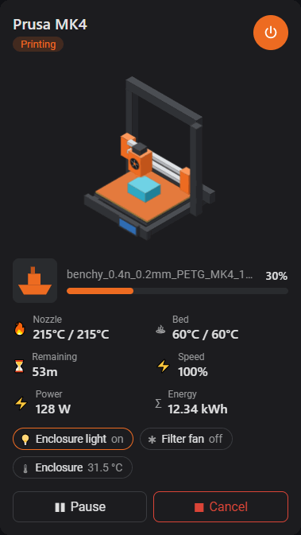
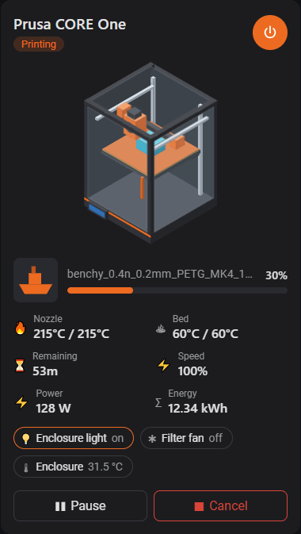
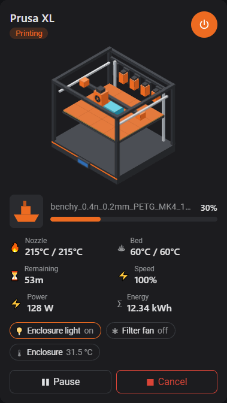

# PrusaLink Card

A Home Assistant Lovelace card for the [PrusaLink](https://www.home-assistant.io/integrations/prusalink/) integration.
It shows an animated isometric Prusa printer (MK4, CORE One or XL), job progress and preview, temperatures,
pause / resume / continue / cancel controls, a power switch, power and energy consumption and any extra entities.

| MK4 | CORE One | XL |
| :-: | :-: | :-: |
|  |  |  |

- The printer animates only while printing, freezes while paused and is dimmed when off.
- The printed object grows with job progress; nozzle and bed glow with temperature.
- When the X/Y position sensors are configured, the toolhead (and the MK4 bed) follow the real position.
- Cancelling a job or switching the printer off during a print asks for confirmation.
- English and Italian, following the Home Assistant user language.

## Installation

### HACS

Add this repository as a custom repository (type **Dashboard**) in HACS, install **PrusaLink Card** and reload the browser.

### Manual

Copy `prusalink-card.js` from the latest release to `config/www/` and add it as a dashboard resource:

```yaml
url: /local/prusalink-card.js
type: module
```

## Configuration

The card can be configured with the visual editor or in YAML:

```yaml
type: custom:prusalink-card
printer_model: mk4 # mk4 | coreone | xl
name: My MK4
state_entity: sensor.mk4
progress_entity: sensor.mk4_progress
filename_entity: sensor.mk4_filename
print_finish_entity: sensor.mk4_print_finish
print_speed_entity: sensor.mk4_print_speed
preview_entity: camera.mk4_preview
nozzle_temp_entity: sensor.mk4_nozzle_temperature
nozzle_target_entity: sensor.mk4_nozzle_target_temperature
bed_temp_entity: sensor.mk4_heatbed_temperature
bed_target_entity: sensor.mk4_heatbed_target_temperature
x_position_entity: sensor.mk4_x_position
y_position_entity: sensor.mk4_y_position
z_height_entity: sensor.mk4_z_height
pause_button_entity: button.mk4_pause_job
resume_button_entity: button.mk4_resume_job
continue_button_entity: button.mk4_continue_job
cancel_button_entity: button.mk4_cancel_job
power_switch_entity: switch.mk4_power
power_entity: sensor.mk4_plug_power # any sensor with device_class power
energy_entity: sensor.mk4_plug_energy # any sensor with device_class energy
extra_entities:
  - light.enclosure_light
  - entity: switch.filter_fan
    name: Filter
    icon: mdi:fan
  - sensor.enclosure_temperature
```

Only `printer_model` and `state_entity` are required; anything not configured is hidden.

Extra entities are shown as chips: switches, lights, fans and input booleans toggle on tap, buttons and
scripts run, anything else opens the more-info dialog. Entries with a custom `name` or `icon` can only be
edited in YAML.

> The PrusaLink temperature and position sensors are **disabled by default** in Home Assistant.
> Enable them in the device page to see temperatures, the heat glow and the real toolhead position.

## Development

```bash
npm install
npm run dev        # rebuild on change + demo page at http://localhost:5000/demo/index.html
npm test
npm run build      # dist/prusalink-card.js
```
